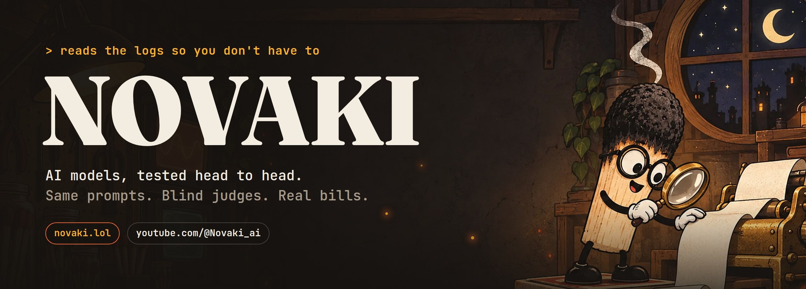
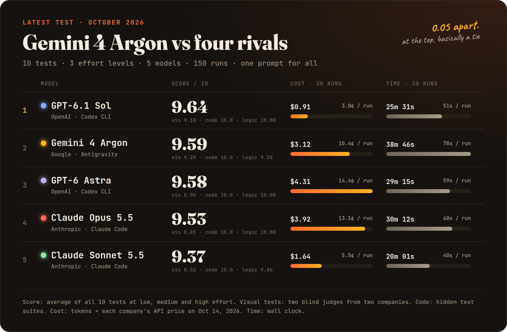

  

  
  
  
  

**Novaki is a matchstick who tests AI models so you don't have to guess.** Every model gets the same prompt, word
for word, at every effort level, and every run is timed and priced at the real API rate. Then everything goes
here: the prompts, every output, the judges' notes and the math.

## Latest test

Same table as text

| # | Model | Score / 10 | Cost (30 runs) | Time (30 runs) |
|---|---|---|---|---|
| 1 | **GPT-6.1 Sol** OpenAI · Codex CLI | 9.64 | $0.91 | 25m 31s |
| 2 | **Gemini 4 Argon** Google · Antigravity | 9.59 | $3.12 | 38m 46s |
| 3 | **GPT-6 Astra** OpenAI · Codex CLI | 9.58 | $4.31 | 29m 15s |
| 4 | **Claude Opus 5.5** Anthropic · Claude Code | 9.53 | $3.92 | 30m 12s |
| 5 | **Claude Sonnet 5.5** Anthropic · Claude Code | 9.37 | $1.64 | 20m 01s |

The two judges did not agree. The GPT-6.1 Sol judge gave its highest visual marks to Sol; the Claude judge put
Argon first. The formula (the average of both judges) was fixed before any result came in, so Sol stays on top,
but at the top it is effectively a tie.

**[All 150 runs: prompts, outputs, judge notes →](https://github.com/novaki-ai/novaki-tests/tree/main/2026-10-gemini-4-argon)**

## How we test

- **One prompt for everyone.** Each model runs in its own official coding agent (Antigravity, Codex CLI, Claude Code)
  at low, medium and high effort, with nothing but the prompt in its context.
- **Blind judges for anything visual.** Recorded frames, two judges from two different companies, a fixed rubric.
- **Machines check the code.** Hidden test suites, and a robot that actually plays the game.
- **Real bills.** Tokens × each company's API price on the day of the test, and wall-clock time for every run.
- **Rules before results.** The scoring formula is written down before the first run. Every run is published,
  the bad ones too.

## Repositories

| | |
|---|---|
| [**novaki-tests**](https://github.com/novaki-ai/novaki-tests) | Prompts, model outputs and scores for every test. `score.py` recomputes every number from the raw results. |

Want a model tested? Tell us under a video on [YouTube](https://www.youtube.com/@Novaki_ai) or on [X](https://x.com/Novaki_ai).

Not sponsored. The narration in the videos is an AI voice; the tests, numbers and sources are real.
